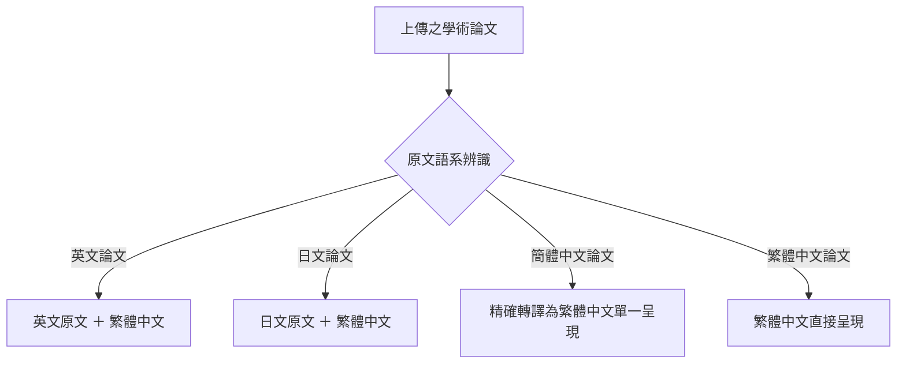
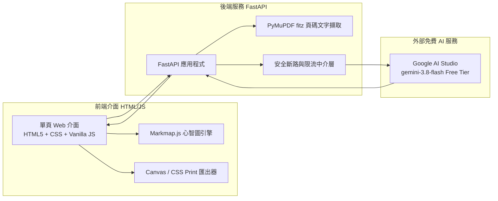
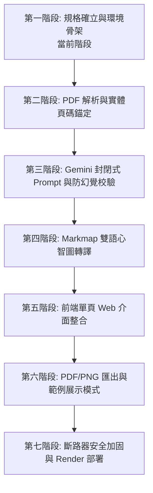

# AI 學術文獻分析與雙語心智圖生成系統
# AI Academic Literature Analyzer & Bilingual Mind Map Generator
## 正式專案開發規格文件 (PROJECT_SPEC.md)

---

## 目錄 (Table of Contents)

1. [專案概述與目的](#一-專案概述與目的)
2. [核心最高原則：原文封閉式摘要與防幻覺機制](#二-核心最高原則原文封閉式摘要與防幻覺機制)
3. [語言動態呈現與排版規格](#三-語言動態呈現與排版規格)
4. [PDF 文件處理與物理頁碼錨定規格](#四-pdf-文件處理與物理頁碼錨定規格)
5. [分析功能與報告深度規格](#五-分析功能與報告深度規格)
6. [文獻基本詮釋資料辨識流程](#六-文獻基本詮釋資料辨識流程)
7. [網頁預覽與檔案匯出規格](#七-網頁預覽與檔案匯出規格)
8. [離線範例展示模式 (Demo Mode) 規格](#八-離線範例展示模式-demo-mode-規格)
9. [零付費原則 (NT$ 0) 與免費額度防護](#九-零付費原則-nt-0-與免費額度防護)
10. [資安防護、隱私與資料生命週期](#十-資安防護隱私與資料生命週期)
11. [建議技術架構候選方案 (待後續實作)](#十一-建議技術架構候選方案-待後續實作)
12. [使用者介面 (UI) 與互動流程設計](#十二-使用者介面-ui-與互動流程設計)
13. [正式專案文件與期中展示交付規格](#十三-正式專案文件與期中展示交付規格)
14. [最終檢核清單與開發規劃](#十四-最終檢核清單與開發規劃)
    - 14.1 已確認之正式需求清單
    - 14.2 尚待確認之技術事項標記
    - 14.3 建議分階段開發順序
    - 14.4 可能遭遇之技術風險與應對方案
    - 14.5 零付費前提下之系統驗證策略

---

## 一、 專案概述與目的

### 1.1 專案背景與痛點
在當前學術研究與高等教育環境中，學生與初階研究人員常需閱讀大量外文（英文、日文等）學術文獻。然而，受限於外語閱讀速度、學術專業詞彙障礙以及繁複的研究架構，閱讀理解的門檻與時間成本極高。若直接使用一般市面上的生成式 AI 摘要工具，往往伴隨「資訊發散、過度腦補、虛構結論、遺失原文章節出處」等嚴重問題，無法滿足學術研究講求精確溯源的基本要求。

### 1.2 專案目的
本系統旨在建構一套**「高精確度、可溯源、原文語言＋繁體中文動態呈現」**之學術輔助分析系統。透過系統化的文字擷取與 AI 萃取技術，達成以下核心目標：
1. **結構化解構論文**：自動梳理文獻之研究背景、研究目的、研究方法、研究成果、核心論點與限制。
2. **全文依據溯源**：每一項萃取之重點均附帶實體 PDF 物理頁碼與原文原句引註，方便快速校對。
3. **動態多語系轉譯**：提供清晰的外語原文與繁體中文整合報告，大幅降低跨語言文獻閱讀負擔。
4. **視覺化心智圖導引**：以結構化階層心智圖呈現文獻架構，協助研究者建立全局視野。
5. **主題關聯性評估**：依據文獻實際內容客觀判斷與使用者研究主題之契合度，輔助文獻篩選決策。

---

## 二、 核心最高原則：原文封閉式摘要與防幻覺機制

本專案將**「原文封閉式摘要（Closed-Domain Grounded Synthesis）」**列為系統不可妥協之最高架構準則。

### 2.1 嚴格禁止事項
AI 模組在系統中的角色僅為「文字萃取與結構化整理引擎」，**絕對禁止**以下行為：
1. **嚴禁外部知識注入**：不得調用預訓練模型自帶的外部歷史、事實或常識庫來補充論文中未提及的細節。
2. **嚴禁主觀推論與腦補**：不得自行推論原文沒有明言的假設、因果關係或未來發展。
3. **嚴禁個人評論與延伸**：不得加入 AI 自身的評估、好壞判斷、心得、建議或延伸研究方向。
4. **嚴禁推測混入作者結論**：不得將 AI 的臆測或普遍常理與作者原本的研究結果混為一談。
5. **嚴禁編造引句與數據**：引述之原文字句必須 100% 取自文本，嚴禁竄改、虛構數據或捏造頁碼。

### 2.2 「原文未提及」剛性標記準則
針對研究方法、樣本規模、研究限制以及使用者指定的特定主題面向，凡原文未明確記載或未探討者，系統必須強制標示：
- **`【原文未提及】`** 或 **`【原文未探討此面向】`**
- 嚴禁留白、模糊帶過或使用「通常可能為…」、「文獻推測…」等虛詞填補。

### 2.3 防幻覺多重工程機制
本系統**絕不單靠提示詞（Prompt）宣稱防幻覺**，而是透過架構層面的多重工程檢核進行約束：
1. **實體頁碼標記注入**：後端解析 PDF 時，自動於文字區塊注入 `[Page N]` 剛性錨點。
2. **封閉領域結構化 Schema**：利用 Gemini API 的 `response_schema` 強制約束輸出格式，規定每一項輸出物件必須包含 `page_number`（整數）、`original_quote`（原文純文字字串）與 `summary_tw`（繁體中文整理）。
3. **後端資料校驗層 (Data Verifier)**：
   - 後端接收到 AI 回傳之 JSON 後，執行字串比對驗證：檢查 `original_quote` 是否真實存在於該 `page_number` 對應的 PDF 文字中。
   - 若引句無法於指定頁面比對吻合，系統標記為警示狀態，防止虛構頁碼與文字。

---

## 三、 語言動態呈現與排版規格

系統捨棄固定的「中英雙語」設定，全面實施**「原文語言＋繁體中文」**之動態分流呈現架構。

### 3.1 語系分流與排版原則

1. **英文論文 (English Literature)**：
   - **呈現規格**：英文原文 ＋ 台灣學術繁體中文。
   - **桌面版介面**：採用左右並排雙欄對照卡片（左側英文原文引句、右側繁體中文整理）。
   - **行動版介面**：採用垂直上下堆疊卡片（上方英文原文、下方繁體中文整理）。
2. **日文論文 (Japanese Literature)**：
   - **呈現規格**：日文原文 ＋ 台灣學術繁體中文。
   - **桌面版介面**：採用左右並排雙欄對照卡片（左側日文原文引句、右側繁體中文整理）。
   - **行動版介面**：採用垂直上下堆疊卡片（上方日文原文、下方繁體中文整理）。
3. **簡體中文論文 (Simplified Chinese Literature)**：
   - **呈現規格**：全域轉換為繁體中文單一呈現。
   - **排版原則**：**嚴禁左右雙欄重複並排**。依據台灣學術用語慣例精確轉譯為繁體中文，避免語意重複與版面冗餘。
4. **繁體中文論文 (Traditional Chinese Literature)**：
   - **呈現規格**：繁體中文直接精準呈現。
   - **排版原則**：**嚴禁左右雙欄重複並排**。單欄呈現結構化重點與原文依據。

### 3.2 套用模組一致性
上述語言規則必須完全無差別套用於以下四大核心模組：
1. **文獻分析綜合報告**。
2. **核心論點與重要重點清單**。
3. **各重點之原文依據與引句對照**。
4. **視覺化心智圖節點內容**（外語論文顯示繁中主節點＋外語原句附註；中文論文顯示純繁中節點）。

---

## 四、 PDF 文件處理與物理頁碼錨定規格

### 4.1 第一版支援範圍與邊界限制
1. **處理篇數**：一次僅支援上傳與分析 **1 篇 PDF**。分析完成後，使用者可清空並重新上傳另一篇論文進行分析。
2. **文件型態**：僅支援**「一般數位原生之文字型 PDF（Digital-native text PDF）」**。
3. **不支援項目**：第一版明確**不支援掃描版 PDF、純圖片 PDF 或 OCR 影像辨識**。若上傳檔案無可擷取之純文字，系統將回傳明確不支援之提示。
4. **頁數上限**：暫定上限為 **50 頁**（*標記為待確認，將依後端記憶體與 Token 壓測結果微調*）。
5. **支援語言**：自動支援英文、日文、繁體中文、簡體中文四種語系之編碼與讀取。

### 4.2 物理頁碼保留與分段機制
1. **1-Based 實體物理頁碼**：
   - 頁碼必須以 PDF 實體檔案之第 1, 2, 3... 頁為基準（Physical Page Index），而非論文內部印刷之自訂頁碼或羅馬數字頁碼，確保使用者於任何 PDF 閱讀器均能依頁碼精確翻查對照。
2. **兩階段/分段擷取與合成流程**：
   - 學術論文篇幅較長，若一次性將整篇 40 頁純文字直接輸入單一 Prompt，極易引發模型專注力分散、頁碼對齊紊亂或觸碰 TPM（每分鐘 Token 數）限流。
   - **分段策略**：
     - **階段一（分段/按頁萃取）**：依頁碼區塊循序注入，提取該頁之關鍵事實、實驗數據與原文摘錄。
     - **階段二（全域聚合與重構）**：彙整各段事實，由模型合成全域性章節大綱、主題關聯度評估與心智圖資料結構。

---

## 五、 分析功能與報告深度規格

系統提供兩種分析模式，兩種模式均採固定完整的分析深度規格。

### 5.1 兩大分析模式定義

#### 模式 A：一般文獻分析 (General Literature Analysis)
- **觸發條件**：使用者未輸入任何特定主題，直接啟動分析。
- **目標**：客觀解構文獻全貌，忠實梳理該篇論文之研究架構與完整結論。

#### 模式 B：主題導向分析 (Topic-Oriented Analysis)
- **觸發條件**：使用者輸入自訂之「報告主題 / 研究主題」。
- **目標**：除產出完整文獻分析外，系統根據論文實際內文，專案評估該論文與使用者主題之契合程度。
- **相關程度三級評定**：
  - **高度相關 (Highly Relevant)**
  - **部分相關 (Partially Relevant)**
  - **低度相關 (Low Relevance / Irrelevant)**
- **相關度判定強制規範**：
  - **嚴禁僅憑關鍵字（Keyword Matching）進行機械判斷**。
  - 必須深入比對論文之「研究目的、變數、實驗方法與結論」是否能實質支援使用者之主題。
  - 必須詳細列出：**具體判定理由、對應之相關章節、支持論點之原文依據、PDF 物理頁碼**，以及**建議使用者優先研讀之特定段落**。
  - 若論文完全未探討使用者主題之某個核心維度，必須直白標註「原文未提及，本論文未探討此維度」。

### 5.2 固定完整分析深度（9 大核心構面）
無論模式 A 或模式 B，產出之分析報告必須包含以下 9 大結構化項目：
1. **文章大綱及章節安排**：梳理各章節標題與對應之頁碼範圍。
2. **研究背景 (Research Background)**：作者進行本研究之動機與欲解決之現狀問題。
3. **研究目的 (Research Objectives)**：論文欲達成之具體核心目標或待答問題。
4. **研究方法 (Methodology)**：研究架構、研究對象、理論模型、實驗設計或質性/量化分析方法。
5. **研究成果 (Research Findings)**：實驗數據、核心發現與關鍵研究事實。
6. **核心論點 (Core Arguments)**：作者立論之主要學術觀點。
7. **重要重點推薦清單**：精選 **5 至 10 個** 最具代表性之核心重點。
8. **重點之逐項原文引註與頁碼**：上述每一重點均必須檢附原文依據（英文/日文/繁中原句）與實體 PDF 物理頁碼。
9. **研究限制 (Research Limitations)**：**僅限原文明確載明者方能列出**；若原文全篇未提及作者自我限制，必須強制填寫「【原文未提及】」，絕不得自行推論或猜測其限制。

### 5.3 雙語心智圖 (Mind Map) 結構規格
心智圖必須嚴格基於已確認之原文分析結果生成，不得無中生有。其核心階層至少包含：
- **Root 節點**：論文題目（繁中轉譯 / 外語原文）
  - **分支 1：研究背景**（附 `[p. X]`）
  - **分支 2：研究目的**（附 `[p. X]`）
  - **分支 3：研究方法**（附 `[p. X]`）
  - **分支 4：核心論點**（附 `[p. X]`）
  - **分支 5：研究成果**（附 `[p. X]`）
  - **分支 6：結論與限制**（限制部分若無則標示「未提及」）
  - *(若為模式 B，增設分支 7：與主題之關聯性)*

---

## 六、 文獻基本詮釋資料辨識流程

為降低使用者手動輸入成本，系統設計基本資料前置確認機制：

1. **自動萃取項目**：
   - **論文標題 (Title)**
   - **作者群 (Authors)**
   - **出版年份 (Publication Year)**
   - **原文語言 (Detected Language)**
2. **人機協同交互機制**：
   - 系統辨識完成後，於前端呈現在「步驟二：確認文章基本資料」卡片中。
   - 使用者具備**完整修改權限**：可直接在輸入框編輯修正誤判之標題或作者，亦可選擇直接「略過/確認繼續」。
3. **防阻斷原則 (Fail-safe)**：
   - 若論文首頁排版特殊導致標題或作者辨識失敗（例如標記為「未知作者」或「未檢出年份」），**絕對不能阻斷後續的核心文獻分析流程**。

---

## 七、 網頁預覽與檔案匯出規格

### 7.1 網頁報告預覽
1. 分析完成後，前端介面即時呈現：
   - **雙語/繁體文獻分析報告預覽區**（具備頁籤切換或分割卡片）。
   - **Markmap.js 互動式心智圖渲染區**（支援節點展開/收合、全螢幕檢視、畫布拖曳與滑鼠滾輪縮放）。
2. **單次呼叫原則**：
   - 預覽展示必須完全重複使用該次分析產出之 JSON 資料結構，**嚴禁為顯示預覽再次呼叫 AI API**。

### 7.2 檔案匯出與下載
1. **PDF 分析報告下載**：
   - 採用瀏覽器原生 `@media print` 列印樣式排版或前端純程式方案（如 `html2pdf.js` / 列印轉存），將排版精美之雙語報告輸出為向量 PDF。
   - 必須維持字型易讀性、雙語對照欄位、分頁標籤與頁碼清晰。
2. **PNG 心智圖下載**：
   - Markmap.js 本質繪製為向量 SVG。前端透過 HTML5 Canvas 將 SVG 節點與樣式轉繪為高解析度（300 DPI）PNG 點陣圖並直接觸發瀏覽器下載。
3. **零消耗保證**：
   - PDF 與 PNG 之匯出轉譯**完全於使用者瀏覽器端完成，絕不消耗伺服器運算與 Gemini API 額度**。

---

## 八、 離線範例展示模式 (Demo Mode) 規格

為確保期中報告展示、評審委員快速審查，或在 API 額度用盡時仍能完整體會系統功能，系統內建一份固定且獨立之示範案例。

1. **範例指定主題**：
   - 英文經典歷史學術論文：**《跨大西洋奴隸貿易》(The Transatlantic Slave Trade)**。
2. **預先生成與固化**：
   - 該範例之分析結果（包含中英雙語分析報告、主題關聯度評估、Markmap 階層樹）預先於開發階段驗證完畢，並直接儲存為靜態 JSON 檔案（如 `sample_slave_trade.json`）隨專案程式碼打包。
3. **點擊交互行為**：
   - 使用者於首頁點選「載入經典範例（跨大西洋奴隸貿易）」按鈕時：
     - **完全不發送任何後端 AI API 呼叫（0 消耗）**。
     - 即刻渲染完整雙語報告與互動心智圖。
     - 完整支援 PDF 下載與 PNG 心智圖下載功能。
     - 介面頂部清楚醒目標註：**「【示範展示模式】此為預先分析完成之示範資料，未消耗任何 AI 額度」**。
4. **時程規劃**：
   - 範例論文文本之選擇、人工審核校驗與靜態 JSON 建置，**安排於後續核心系統管線開發完成後進行**。

---

## 九、 零付費原則 (NT$ 0) 與免費額度防護

本專案自開發、單元測試、整合測試至期中展示，**整體支出必須為嚴格之 NT$ 0**。

### 9.1 硬性禁止條款
1. **嚴禁綁定信用卡**：不得在任何雲端平台或 API 後台輸入信用卡號。
2. **嚴禁啟用付費帳單**：不得啟用任何隨用隨付（Pay-As-You-Go）或付費升級設定。
3. **嚴禁自動扣款與備援**：不得設置任何「當免費額度不足時自動轉換至付費模型或付費服務」的邏輯。
4. **誠實原則**：不得對外宣稱第三方免費服務為「永久免費」或「100% 永不斷線保證」。

### 9.2 免費額度耗盡防禦（斷路器架構）
1. **短期併發超限 (RPM/TPM 429)**：
   - 若遇到短期瞬間請求過頻，後端依據標頭啟動短暫指數退避（Exponential Backoff，等待 5~10 秒後自動重試 1~2 次）。
2. **每日總額度耗盡 (Daily Quota Exhaustion 429)**：
   - 當監測到當日配額已滿時，系統啟動**安全斷路器**：
     - 立即停止接收新的 AI 分析請求。
     - 絕不嘗試切換至任何收費 API。
     - 介面清晰發出公告說明：「今日免費 AI 配額已達上限，系統已安全暫停分析（明日午夜重置）。您仍可正常使用預先載入的『範例展示模式』以及下載功能。」
     - 保留使用者當前已完成的分析畫面與瀏覽器快取。

---

## 十、 資安防護、隱私與資料生命週期

### 10.1 零歷史與無資料庫架構
1. **免登入系統**：本系統為公開學術工具，使用者無需註冊或登入。
2. **無資料庫設計**：後端不架設任何 SQL 或 NoSQL 資料庫，不儲存使用者的歷史分析紀錄。
3. **無痕檔案生命週期**：
   - 上傳之 PDF 僅以隨機雜湊 UUID 建立暫存檔存放於伺服器之暫存目錄（如 `/tmp/`）。
   - 分析完成後排程銷毀；若發生錯誤或逾時，由定時背景機制強制清空。
   - **重分析機制**：若使用者欲更換分析主題，且該檔案之暫存生命週期尚未過期，可直接沿用暫存快取，無需重新上傳 PDF。

### 10.2 金鑰安全保護 (Secrets Management)
1. **伺服器端環境變數專用**：
   - 管理者申請之 Gemini API Key 僅能存放在伺服器環境變數（如 Render Dashboard 之 `Environment Variables`）或本機 `.env`。
2. **三不原則**：
   - **絕不**出現在前端 HTML/JavaScript 程式碼中。
   - **絕不**寫死於後端原始碼中。
   - **絕不** Commit 推送至公開 GitHub Repository（必須由 `.gitignore` 嚴密阻絕）。
3. **隱私提示聲明**：
   - 鑑於 Google AI Studio 免費層之資料政策規範，系統於首頁上傳區明確標註警語：
     > 「本系統使用免費研發額度，僅供公開發表之學術文獻分析。請勿上傳涉及商業機密、未公開研究或包含個人敏感隱私之文件。」

---

## 十一、 建議技術架構候選方案 (待後續實作)

*本章節僅列出建議技術選型作為未來開發之藍圖，本階段不進行安裝或實作：*

1. **後端運算核心**：Python 3.13 搭配 **FastAPI**（高並發非同步、輕量、無多餘依賴）。
2. **PDF 解析引擎**：**PyMuPDF (`fitz`)**（純本地 C 加速、零雲端成本、精確支援 1-based 物理頁碼與多欄排版）。
3. **AI 推理引擎**：**Google AI Studio - `gemini-3.8-flash` 免費層**（支援 1M 上下文、原生多語系、支援結構化 JSON Schema）。
4. **前端呈現技術**：原生 HTML5 + 現代 CSS + 原生模組化 JavaScript（ES Modules，無需複雜前端打包編譯工具鏈）。
5. **心智圖渲染器**：**Markmap.js**（開源、支援 Markdown 階層語法、支援縮放拖曳、原生向量 SVG 輸出）。
6. **PDF 報告輸出**：瀏覽器原生列印樣式表（`@media print`）搭配自訂列印排版。
7. **PNG 心智圖輸出**：純前端 HTML5 Canvas 轉繪 SVG 技術（零後端負擔）。
8. **雲端公開部署平台**：**Render Hobby Free Plan**（第一候選平台，支援 Python Web Service，完全免信用卡）。
9. **金鑰管理**：Render 雲端後台之 Environment Variables / Secrets。

---

## 十二、 使用者介面 (UI) 與互動流程設計

### 12.1 視覺風格規範
- **學術簡約風格**：整體基調乾淨、專業、專注於文獻內容閱讀。
- **色彩系統**：
  - 背景色：純白 (`#FFFFFF`) 或 淺灰色 (`#F8FAFC`)。
  - 主要點綴色：深藍色（如學術海軍藍 `#1E3A8A` / `#2563EB`），用於按鈕、標籤與核心重點高亮。
  - 輔助色：中性灰 (`#64748B`) 用於引文註釋；綠色/橘色用於標籤分類。
- **介面佈局**：卡片式排版（Card-based UI），具備直覺的陰影與圓角。
- **響應式支援**：支援電腦寬螢幕、筆電與手機螢幕（第一版暫不開發深色模式）。

### 12.2 首頁五步驟直覺導引流程
首頁核心操作區域清晰劃分為五大引導步驟：
1. **步驟一：上傳學術文獻**
   - 拖曳或點選上傳 PDF 檔案。
   - 標記規範：限一般文字型 PDF、單次限上傳一篇、頁數建議 50 頁內。
   - 醒目標註「載入示範論文（跨大西洋奴隸貿易）」快捷按鈕。
2. **步驟二：確認文章基本資料**
   - 呈現自動檢測之論文標題、作者、出版年份與語言。
   - 使用者可直接修改文字框，或點擊「確認無誤 / 略過」。
3. **步驟三：選擇分析模式**
   - 單選卡片：「模式 A：一般文獻分析」或「模式 B：主題導向分析」。
   - 若選擇模式 B，動態展開主題輸入框（附帶提示：「請輸入欲檢驗之研究主題或報告方向」）。
4. **步驟四：等待分析處理**
   - 呈現清晰的階段進度條與動畫提示（如：「解析 PDF 物理頁碼中...」→「萃取研究核心論點中...」→「構建雙語心智圖中...」）。
   - 設有友善之 Render 冷啟動等候與速率緩解提示。
5. **步驟五：查看報告、互動心智圖與匯出**
   - 分頁切換檢視：「文獻分析報告」與「互動心智圖」。
   - 提供「下載 PDF 報告」與「下載 PNG 心智圖」兩大快捷按鈕。

---

## 十三、 正式專案文件與期中展示交付規格

為符合正式學術專題與期中報告審查標準，本專案後續將完整產出以下規範物件：

1. **GitHub Repository 結構規範**：
   - 包含規範化之 `README.md`。
   - 完整標註開源協議（如 MIT License）。
   - 嚴格的 `.gitignore`（嚴防 `.env`、快取與暫存檔推送）。
2. **README.md 必備章節**：
   - 專案名稱與簡介。
   - 核心功能特色與「原文封閉式摘要」防幻覺架構說明。
   - 系統架構圖與工作流程圖。
   - 本地端安裝、環境配置與啟動執行指引。
   - Render 雲端公開部署操作指南。
   - 系統已知限制（如暫不支援掃描 PDF）。
   - 未來擴充藍圖（Roadmap）。
   - 系統展示操作截圖。
3. **開發者資訊揭露標準**：
   - 專案名稱：AI學術文獻分析與雙語心智圖生成系統。
   - 開發者姓名：標註開發者個人真實姓名。
   - 所屬課程名稱：標註所屬大專院校及修讀課程名稱。
   - GitHub 專案連結：附帶完整可訪問之公開 Repo 網址。
   - **隱私邊界**：**嚴格不公開學生學號（Student ID）**。
4. **期中報告展示雙軌準備**：
   - **軌道一（正式雲端網址）**：Render 提供之公開 HTTPS 網址，供評審非同步點閱。
   - **軌道二（現場安全備案）**：內建之「範例展示模式」＋ 必要時啟用之「Cloudflare Quick Tunnel 本機穿透」，確保報告現場 100% 順暢。

---

## 十四、 最終檢核清單與開發規劃

### 14.1 已確認之正式需求清單
- [x] 專案全程總花費保證 NT$ 0，嚴禁填入信用卡或啟用付費服務。
- [x] 確立「原文封閉式摘要」為最高原則，嚴禁推論、補充與腦補。
- [x] 未載明資訊強制標示「原文未提及」。
- [x] 所有論點必須附帶實體 PDF 物理頁碼與原文引據。
- [x] 確立「原文語言＋繁體中文」動態分流呈現（外語雙語對照、中文單一繁中）。
- [x] 確立模式 A（一般分析）與模式 B（主題導向分析，深層比對非關鍵字匹配）。
- [x] 確立 9 大固定深度分析項目與心智圖必備分支。
- [x] 確立基本詮釋資料（標題/作者/年份/語言）可手動修改且失敗不阻斷。
- [x] 確立網頁預覽、PDF 下載、PNG 心智圖下載完全零消耗額外 AI 額度。
- [x] 確立範例展示模式以英文《跨大西洋奴隸貿易》為主題，採靜態 JSON 封裝。
- [x] 確立無資料庫、免登入、暫存檔定時清理之資安原則。
- [x] 確立 Gemini API Key 僅存於伺服器端 Secrets，嚴禁外流。
- [x] 確立模型採用 `gemini-3.8-flash`，建置 HTTP 429 雙分流斷路器。

---

### 14.2 尚待確認之技術事項標記 (Pending Confirmations)

以下項目受限於雲端免費層與實際硬體極限，**標記為「待確認」，必須於後續實作階段透過實際壓測驗證後方能定案**：

| 事項編號 | 待確認事項內容 | 技術疑慮與驗證標準 | 暫定防護對策 |
| :--- | :--- | :--- | :--- |
| **PEND-01** | **PDF 頁數上限 50 頁之可行性** | 50 頁之論文經 PyMuPDF 解析後的純文字 Token 量約為 30,000~60,000 Tokens。需實測在 Render **512 MB RAM** 限制下，是否會因瞬時記憶體膨脹引發 OOM 崩潰。 | 若壓測發現 50 頁容易觸發記憶體瓶頸，將於實作時將建議上限調整為 30 頁。 |
| **PEND-02** | **單次分析端到端連線逾時** | Render 路由層支援 100 分鐘，但**客戶端瀏覽器**在等候多頁分段分析（可能需 30~50 秒）期間，是否有部分網路環境會自動切斷 TCP 連線。 | 待實測瀏覽器端行為。若發生中斷，需評估是否導入 Server-Sent Events (SSE) 串流回報進度。 |
| **PEND-03** | **Gemini 3.8 Flash Free Tier 之實際 RPM/RPD** | Google 官方文件註明免費層配額是依專案動態配置，無法於事前保證固定數值。 | 待後續申請 API Key 後登入 AI Studio 控制台，方能確認該專案的實際動態速率。 |
| **PEND-04** | **Render 750 小時配額之多服務衝突** | 750 小時為整個 Render Workspace 共用。若個人帳號曾部署過其他服務，配額將提前耗盡。 | 待部署前檢查該 Render 帳號，確認處於完全乾淨之單一服務狀態。 |
| **PEND-05** | **瀏覽器 LocalStorage 容量極限** | 分析結果之完整 JSON（含各頁引註）大小約介於 50 KB ~ 200 KB 之間，一般瀏覽器 LocalStorage 上限為 5 MB。 | 需於實作時確認資料序列化後體積，確保不會超過瀏覽器本機儲存上限。 |

---

### 14.3 建議分階段開發順序 (Phased Roadmap)

1. **第一階段：規格確立與環境初始化（當前階段完成）**
   - 建立正式 `PROJECT_SPEC.md`。
   - 使用者審閱確認後，建立 `.gitignore`、Python 虛擬環境 (`.venv`) 與 `requirements.txt`。
2. **第二階段：PDF 核心解析引擎開發 (`pdf_engine.py`)**
   - 實作 PyMuPDF 文字抽取模組。
   - 驗證 1-based 物理頁碼精確錨定與雙欄學術排版讀取順序。
   - 實作英文、日文、繁中、簡中之語系自動辨識邏輯。
3. **第三階段：Gemini API 封閉領域分析模組 (`gemini_service.py`)**
   - 撰寫嚴格防幻覺之 System Prompt。
   - 定義結構化 JSON Schema。
   - 實作兩階段分析（分頁萃取 ＋ 全域合成）與主題相關度判斷。
   - 實作引註字串後端二次校驗與「原文未提及」檢核。
4. **第四階段：動態心智圖資料轉譯模組 (`mindmap_engine.py`)**
   - 依原文語系分流產生 Markmap 相容之 Markdown 階層結構。
5. **第五階段：Web 介面與前後端整合 (`main.py` + 前端)**
   - 建立 FastAPI 路由端點。
   - 實作首頁五步驟 UI（上傳、確認基本資料、選模式、等候、預覽）。
   - 實作外語左右對照與中文單一呈現之響應式版面。
   - 實作前端 LocalStorage 快取防中斷機制。
6. **第六階段：匯出功能與範例模式建置**
   - 實作前端 Canvas 轉繪 PNG 下載。
   - 實作雙語報告 `@media print` PDF 列印下載排版。
   - 製作《跨大西洋奴隸貿易》經典範例之靜態 JSON 資料。
7. **第七階段：配額防禦、資安加固與雲端公開部署**
   - 實作 HTTP 429 雙分流斷路器與檔案大小硬性限制閥。
   - 撰寫 Dockerfile 或 Render 建置組態。
   - 部署至 Render 免費個人帳號並驗證公開 HTTPS 網址。
   - 撰寫正式 `README.md`。

---

### 14.4 可能遭遇之技術風險與應對方案

| 風險項目 | 觸發情境 | 系統性因應與緩解對策 |
| :--- | :--- | :--- |
| **記憶體溢出 (OOM)** | 使用者上傳超過 30 頁且圖檔極多之高解析度學術論文，導致 Render 512MB RAM 耗盡。 | 後端中介層強制設定上傳上限（10MB / 暫定 50 頁，視 PEND-01 調整）。文字抽取完畢後立即執行 `doc.close()` 與 Python 垃圾回收 (`gc.collect()`)。 |
| **期中展示冷啟動延遲** | Render 免費實例於 15 分鐘無連線後休眠，評審現場點開需等候約 60 秒。 | 1. 報告前 5 分鐘由報告者預先訪問網址喚醒實例。 2. 前端介面載入時提供友善之動畫提示。 3. **終極保險**：現場直接點擊「載入示範模式」，0 秒無縫展示。 |
| **API 額度臨時耗盡** | 展示當天因多次測試或外部使用者頻繁調用，觸及 Google 免費層當日配額。 | 系統自動斷路器攔截，介面明確呈現額度已滿告示；立即無縫切換為「範例展示模式」向評審完整演繹各項功能。 |
| **論文引句無法完全對齊** | 部分 PDF 特殊排版或連字號（Hyphenation）導致 AI 輸出的原文引句比對有些微字元誤差。 | 後端比對演算法導入模糊字串比對（Fuzzy Matching）輔助，若容忍度內吻合則自動修正定位，避免誤判。 |

---

### 14.5 零付費前提下之系統驗證策略

在不投入任何金錢、不綁定信用卡的嚴格前提下，後續將依循以下策略分層驗證系統之可靠性：

1. **本機端單元隔離驗證（零成本）**：
   - 準備 4 篇具備公開版權之開源學術論文（英文、日文、簡中、繁中各 1 篇）。
   - 於本機端執行 PyMuPDF 文字抽取測試，計算每頁解析之記憶體佔用峰值與實體頁碼準確性。
2. **AI 封閉性與防幻覺檢核驗證（限量免費 API 額度）**：
   - 使用管理者申請之免費 API Key，於本機進行少量（1~2 次）測試。
   - 人工逐項核對產出之引句與 PDF 原文物理頁碼，確認是否存在任何非原文之主觀論述。
   - 刻意提供論文完全未探討之主題，檢驗系統是否確實標註「【原文未提及】」。
3. **Render 免費環境壓測驗證（零成本）**：
   - 將專案推至乾淨之 Render 個人免費帳號。
   - 觀察空載記憶體開銷與進行單次分析時的記憶體波動，確認維持在 512 MB 安全線內。
   - 驗證休眠後喚醒時間與前端 LocalStorage 重新整理快取復原機制。
4. **期中報告全真模擬演練（零成本）**：
   - 斷開外部 API 網路，模擬極端斷線情境，驗證「範例展示模式」能否在 0 API 支援下完整演繹網頁預覽、PDF 列印與心智圖 PNG 匯出。
